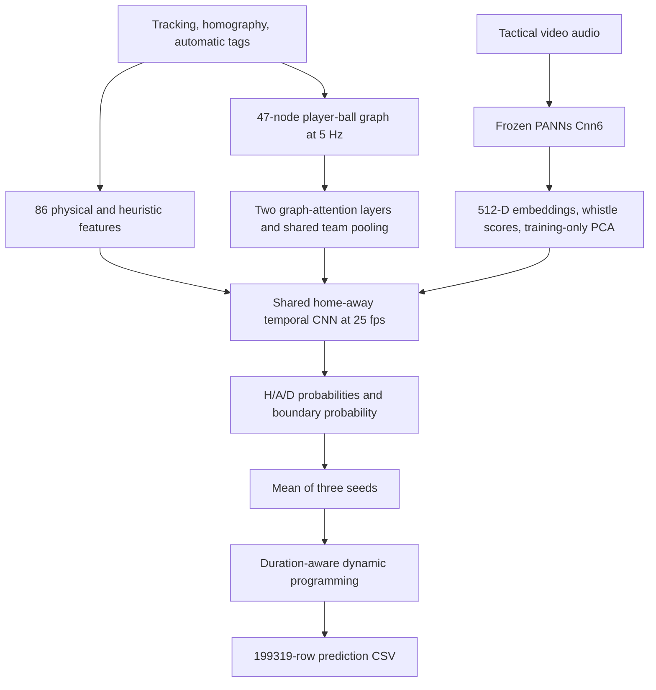

# Barca Hack: tracking and audio for football possession

This repository predicts **Barcelona possession (`H`), Athletic possession (`A`),
dead ball (`D`), or outside the graded halves (`X`) for every frame** of the
BAR–ATH tactical recording in More than a Hack 2027, Phase 1.

The packaged candidate combines a **player–ball graph, frozen PANNs audio
features, a shared temporal CNN, and a duration-aware decoder**, averaging three
trained seeds. Its highest observed draft-validation **spell F1 is 0.7200**.
The 0.80 target has **not** been reached. There is no hidden full-match score,
and the small validation window has been reused during development.

**Start here:** [download the model and predictions](https://github.com/kavishj/Barca_hack/releases/tag/best-graph-panns-072-v1),
[run the saved model](#run-the-saved-model), or read the
[technical model document](best_model/TECHNICAL_MODEL.md).
The repository is currently private; collaborators need GitHub access and their
own licensed match bundle.

## Deliverables

| Item | Location | Purpose |
|---|---|---|
| Prediction CSV | [submissions/Barca_hack_possession.csv](submissions/Barca_hack_possession.csv) | Preserved, unedited algorithm output in submission format |
| Code and weights | [Release `best-graph-panns-072-v1`](https://github.com/kavishj/Barca_hack/releases/tag/best-graph-panns-072-v1) | Approximately 22 MB ZIP with source, three checkpoints, preprocessing, frozen PANNs checkpoint, manifest and reproduction records |
| Runner source | [best_model/predict_best.py](best_model/predict_best.py) | Entry point included in the release; run it from the complete extracted ZIP |
| Technical details | This README and [best_model/TECHNICAL_MODEL.md](best_model/TECHNICAL_MODEL.md) | Design decisions, training, measurements and limitations |
| Experiment history | [EXPERIMENT_RESULTS.md](EXPERIMENT_RESULTS.md), [F1_TARGET.md](F1_TARGET.md) | Results and fixed protocols, including unsuccessful alternatives |
| Teammate's original solution | [ORIGINAL_V6_README.md](ORIGINAL_V6_README.md), [TECHNICAL.md](TECHNICAL.md), [SOLUTION.md](SOLUTION.md) | Historical deterministic v6 baseline |

The release excludes match video, tracking exports, frame-level feature caches
and additional human annotations. A separate private ready-to-run archive exists
for the team; its licensed-data-derived observation caches are **not uploaded to
GitHub**. The published CSV is a prediction file, not a reference answer key.
This GitHub release does not submit an entry to the competition.

[Release checksums](best_model/release_checksums.json) record the ZIP and CSV
hashes. The [release manifest](best_model/release_manifest.json) records the
original-input, source and model/preprocessing hashes. It belongs to the frozen
archive, rather than to every later research revision in this repository.

## Problem and dataset

The task asks who controls the ball, rather than who most recently touched it or
which player is nearest. Live possession spells and their transition times matter.
Stoppages and restart preparation are `D`. A contested or temporarily invisible
ball does not automatically imply either a turnover or a stoppage.

The output clock is the **tactical video**: **199,319 frames at 25 fps**. Tracking
has a separate counter. The broadcast camera has a different timeline and is
not used by this candidate. We decode each graded half independently:

| Half | First video frame | Last video frame, inclusive |
|---|---:|---:|
| First | 11,185 | 90,651 |
| Second | 110,808 | 190,197 |

Every graded frame receives `H`, `A` or `D`; other frames receive `X`. The CSV
header is exactly `frame,label`, with frame IDs 0 through 199318.

| Original tactical asset | Contribution |
|---|---|
| `BAR-ATH_tactical.mp4` | Stadium audio, including possible whistles; the selected model does not run an RGB video encoder |
| `BAR-ATH_tactical_atd.xml` | Tracking metadata and player/team information |
| `BAR-ATH_tactical_atd.txt` | Player and ball positions and motion observations |
| `BAR-ATH_tactical_homography.csv` | Camera geometry used by the inherited observation feature pipeline |
| `BAR-ATH_tactical_smart_tagging.xml` | Supplied automatic event/phase hints; noisy observations, not corrected possession truth |

Three data issues shape the approach:

1. **The ball is absent in about 41% of graded frames.** Nearest-player rules
   cannot solve this alone. Availability masks and temporal context are essential.
2. **Tracking/video alignment differs between halves.** Per-half offsets in
   [games.py](games.py) align tracking to the submission clock. Audio extraction
   preserves timestamps, and interpolation does not cross halftime.
3. **Tracking is imperfect.** The inherited loader corrects goalkeeper team
   assignments using the goal they guard. Graph velocity features reject
   implausible slot jumps. Missing positions are distinguished from real zeros.

Normalized tracking coordinates are converted using the 105.3 × 68.0 m pitch.
[DATA.md](DATA.md) explains the organiser's data contract;
[HACKATHON_BRIEF.md](HACKATHON_BRIEF.md) records measured data properties.

## Architecture



The graph has **46 player slots and one ball token**, with **15 features per
node** covering position, velocity, ball-relative information, goalkeeper status
and observation masks. It is sampled every five video frames. Two attention
layers use width 32, four heads, geometric-distance biases and same-team biases.
Shared pooling produces a representation for each team, interpolated back to
exact video frames.

Home and away share temporal weights. Six residual TCN blocks use width 32,
dilations **1, 2, 4, 8, 16, 32**, and two 3-wide convolutions per block. The radius
is 126 frames, approximately five seconds on either side. This is an **offline**
method using future observations; context resets at halftime.

Two latent logits per team are aggregated into its owner score. They are not
independently verified "control" and "transit" labels. Dead-ball and boundary
heads consume team means and absolute differences, preserving their outputs
when H and A are swapped.

| Component | Registered parameters | Fitted on this match? |
|---|---:|---|
| Graph + temporal network, one seed | 74,999 | Yes, on known training windows |
| Three seed networks | 224,997 total | Yes; probabilities are averaged |
| PANNs Cnn6, including spectral frontend | 5,920,911 | No; frozen public AudioSet checkpoint |
| PCA, scaling, duration priors | Small saved statistical transforms | Yes; training observations/labels only |

The per-seed count includes memory/span modules registered for ablations. Those
branches are disabled in the selected `graph_tcn` arm. The release does not use
CLAP, AST, an LLM, external ownership pretraining or the later phase-hint override.

## Why these decisions

These are the implementation motivations. They should not be read as proof that
each component improves an unseen fixture; measured comparisons follow below.

| Decision | Reason and tradeoff |
|---|---|
| Tracking plus audio | Geometry provides control evidence; sound provides independent stoppage cues during visual occlusion. Neither identifies every possession change reliably. |
| Player–ball graph | Control depends on relationships, pressure and surrounding players, beyond a single nearest distance. Attention models those relationships. |
| Shared home/away parameters | The possession rule should not depend on the club's numeric ID. Sharing reduces capacity and enforces team-swap consistency. Tests also check player-slot permutation invariance. |
| Graph at 5 Hz, outputs at 25 Hz | Spatial attention is more expensive than interpolation. Lower-rate graph computation saves work, while physical features and the TCN retain frame-level timing. |
| Small TCN | There are few labeled windows. Dilated convolutions give temporal context with modest trainable capacity and efficient whole-window inference. Parameter count alone is not a selection criterion. |
| Frozen PANNs | AudioSet pretraining supplies acoustic knowledge without new referee-whistle labels. Freezing limits overfitting and fits free Kaggle GPU experiments. Whistle/Whistling scores are generic, not referee certification. |
| Embeddings plus whistle scores | Crowd noise, silence and broader sound context may help. A detected whistle is evidence, not a hard instruction to emit `D`. |
| Audio PCA-32 | Hundreds of acoustic channels are excessive for the supervision available. Dimensionality reduction and scaling are fitted inside each training fold, then saved. |
| Auxiliary boundary prediction | Frame classification can blur possession endpoints. Boundary supervision targets transitions that directly affect spell F1, without manually correcting output. |
| Three fixed seeds | Small-data training varies with initialization. Averaging seeds 0/1/2 reduces that variance at the cost of three small-head forward passes. |
| Segmental decoding | Independent frame argmax creates flicker and extra spells. The decoder balances state evidence, boundary evidence, switch fees and soft duration preferences. |
| Soft duration penalties | Genuine short possessions/stoppages must remain possible. Unlike historical v6, this decoder imposes no hard minimum duration. |
| Supplied pre-kickoff dead interval | Frames 110808–113741 precede second-half kickoff and are set to `D` by the original decoder. This is a published match fact, not a private-label correction. |
| Saved artifacts and hashes | Exact reproduction requires preserved weights, transforms and inputs. Hash checks expose accidental substitutions and source drift. |
| Keep unsuccessful experiments | Larger backbones and more machinery sometimes improve one split and fail another. The ledger prevents reporting only favorable outcomes. |

### Decoder details

For each half, dynamic programming combines summed log H/A/D probabilities,
transition evidence, **switch cost 8**, and soft duration priors fitted from
complete training segments. Candidate edges include a one-second grid, state
argmax changes and boundary peaks. Optimization is exact on that candidate graph,
not over every possible frame edge. Half-edge segments are treated as censored
for duration penalties.

Loose-ball, duel and restart behavior comes from physical observations and the
available supervision. Stoppage/restart preparation is `D` in the team's review
annotations. These semantics remain imperfect on ambiguous episodes.

## Training and evaluation

Supervision combines the published five-minute reference with the existing
bounded review annotations supplied by the team. Draft annotations retain their
provisional status. Unmarked prefixes and open annotation tails stay unknown;
they are never filled to manufacture extra labels. Additional review files are
not redistributed.

| Split | Known frames | Time | Live spells |
|---|---:|---:|---:|
| Training, five windows | 21,787 | About 14.5 min | 33 |
| Separate draft-validation window | 4,078 | About 2.7 min | 9 |

Training windows, as half-open video-frame intervals:
`[11185,18685)`, `[70395,73265)`, `[83236,86758)`,
`[122898,126864)`, `[183054,186983)`.

Each saved seed uses:

- AdamW, learning rate **0.001**, weight decay **0.001**, dropout **0.15**.
- **60 fixed epochs**, cosine learning-rate schedule and gradient clipping 1.0;
  no validation-driven early stopping.
- Whole known windows, with observation context. Only known training frames
  contribute to loss; unknown/context frames are not pseudo-labels.
- Natural-frequency state cross-entropy plus **0.25 × weighted boundary BCE**.
  Boundary positive weight is capped at 20; inference subtracts its log weight
  before applying sigmoid. No span loss is active in this candidate.
- Mono **32 kHz** audio, **two-second clips every half second**, aligned within
  halves. The 512-D embedding becomes 32 PCA channels; generic whistle scores
  and availability remain available to the feature stack.

Diagnostic cross-validation holds out **entire windows with a 60-second purge**.
Adjacent frames are never randomly split. Scaling, audio PCA and duration priors
are refitted on each fold's remaining training data. The original architecture
diagnostics used one seed per fold; later matched comparisons use all three
seeds, as deployment does.

The official ranking metric is **one-to-one live-possession spell F1**, averaged
over temporal IoU thresholds **0.3, 0.4, 0.5, 0.6, 0.7**. Correctly classifying
many frames can still merge or fragment possession intervals. **Frame macro F1
is secondary, and does not replace spell F1.** See [EVALUATION.md](EVALUATION.md).

### Measured results

| Candidate | Matched three-seed training-window OOF spell F1 | Draft-validation spell F1 | Draft-validation frame macro F1 |
|---|---:|---:|---:|
| **Packaged graph + PANNs + TCN** | **0.4881** | **0.7200** | **0.6792** |
| Direct external ownership expert | 0.6067 | 0.6824 | 0.6485 |
| CLAP audio + external ownership | 0.6400 | 0.5500 | 0.6309 |

OOF means out-of-fold predictions on held-out training windows. These columns
cover different windows and should not be averaged. The original graph's
historical **one-seed** OOF was 0.5123; 0.4881 is its matched **three-seed** result.
CLAP's OOF frame macro F1 was 0.8438, which does **not** meet the 0.80 spell-F1 goal.

The packaged graph predicts six live spells on the nine-spell validation window.
We preserve it as the **highest observed validation candidate**, not a proven
winner on unseen data. The original architecture comparison used that validation
window, and all development windows have since been reused. Later studies chose
variants by training-window OOF before scoring the selected variant on validation;
that does not erase earlier selection bias. No untouched final-test result exists.

### Alternatives tried

Memory and span-supervised graph variants scored 0.6400 and 0.6667 on the original
draft validation, below the graph's 0.7200. A frozen 5.94B visual encoder produced
no better observed validation result. Public Metrica pass pretraining improved
an external ownership expert's matched OOF, but did not beat the packaged model
on validation. CLAP improved OOF and regressed on validation. Fixed audio fusion,
shorter training and a tabular dead-ball expert did not promote a replacement.
These are alternative experiments, not components all enabled in the release.

See [RELATIONAL_EXPERIMENT.md](RELATIONAL_EXPERIMENT.md),
[TCN_AUDIO_EXPERIMENT.md](TCN_AUDIO_EXPERIMENT.md),
[EXTERNAL_PRETRAINING.md](EXTERNAL_PRETRAINING.md) and
[EXPERIMENT_RESULTS.md](EXPERIMENT_RESULTS.md) for protocols and outcomes.

## Run the saved model

### 1. Download

Open the [release page](https://github.com/kavishj/Barca_hack/releases/tag/best-graph-panns-072-v1)
and download `barca_best_code_weights.zip`. The separate
`Barca_hack_possession.csv` is available if you only need predictions. All model
weights, including PANNs, are bundled; inference needs no model-host API key.

Alternatively, use GitHub CLI authenticated with repository access:

```bash
gh release download best-graph-panns-072-v1 \
  --repo kavishj/Barca_hack \
  --pattern barca_best_code_weights.zip \
  --pattern Barca_hack_possession.csv \
  --dir ./downloads
python -m zipfile -e downloads/barca_best_code_weights.zip ./downloads
cd downloads/barca_best_model
```

Use the **complete extracted release** for exact reproduction. The repository
contains evolving research code; the ZIP freezes inference source and its
manifest. A bare clone's `best_model/predict_best.py` needs companion files
provided in the ZIP before it can run.

### 2. Install

Use Linux and Python **3.12 or 3.13**. For CPU:

```bash
python -m venv .venv
source .venv/bin/activate
python -m pip install -r requirements.txt
python -m pip install -r requirements-cpu.txt
```

The release pins NumPy, pandas, SciPy, scikit-learn, joblib, threadpoolctl and
PyAV. CPU requirements pin PyTorch 2.8.0. A separate `ffmpeg` executable is not
required by this runner.

**On Kaggle:** enable a GPU, attach your private licensed match dataset, extract
the ZIP into `/kaggle/working`, and install `requirements.txt`. Preserve Kaggle's
CUDA-enabled PyTorch; **do not install `requirements-cpu.txt` there**. Raw-asset
reproduction was verified on a Tesla T4 with PyTorch 2.11.0+cu130.

### 3. Generate from original assets

From the extracted `barca_best_model` directory:

```bash
python predict_best.py \
  --data-dir /path/to/licensed/match/bundle \
  --work-dir /path/to/writable/work \
  --out submission_generated.csv \
  --device cuda
```

Use `--device cpu` if needed; full-video audio extraction will be slower. On
Kaggle the data root can be `/kaggle/input/barca-hack`, with work written to
`/kaggle/working/barca_inference`.

The runner recursively locates each of the five filenames. Each must occur
exactly once and match its original content hash. Folder nesting and modification
times may differ. Reserve several GB of writable working space for intermediate
tracking/audio arrays, in addition to the original assets. Input mounts may be
read-only.

It rebuilds physical features, the graph and PANNs audio, applies saved transforms,
runs three seeds, averages probabilities and decodes both halves. It accepts
**no reference-label paths** and does not read the downloadable prediction CSV.
The final expected-hash check occurs **after inference**; mismatch raises an
error rather than changing predictions.

Team members with the exact private observation caches may instead run:

```bash
python predict_best.py --cache-dir /private/exact_observation_caches \
  --out submission_generated.csv --device cpu
```

The directory must contain manifest-matching `features.npz`, `audio_cache.npz`
and `graph.npz`. These optional match-derived caches are not on GitHub.

### 4. Validate and verify

```bash
python evaluation/validate_submission.py submission_generated.csv
sha256sum submission_generated.csv
```

Expected SHA-256:

```text
c5dd08253f385e37cbdcb0f32006fde09ea65ada622a8f9548524cab6d633857
```

The runner writes `submission_generated.csv.verification.json` with the
actual/expected hashes, row count, device and input route. The official validator
confirms 199,319 ordered rows. The preserved output contains H=63,739, A=36,868,
D=58,250 and X=40,462. These counts describe predictions, not verified match truth.

Three completed checks reproduced identical bytes: cached CPU inference,
inference from an extracted portable archive, and a private Kaggle raw-asset
GPU run with **no observation caches, annotations or stored predictions attached**.
See [best_model/VERIFICATION.md](best_model/VERIFICATION.md) and
[best_model/REPRODUCTION_VERIFICATION.json](best_model/REPRODUCTION_VERIFICATION.json).
Reproduction establishes the same file, not that every predicted label is correct.

Rename the CSV to the team name if required, preserving its contents. The
organiser's [SUBMISSION.md](SUBMISSION.md) describes the remaining deliverables.

## Train or extend it

Saved-model inference needs no labels. **Retraining does:** additional team
review files are not distributed, so a clone cannot recreate those annotations.
The public reference can exercise the code but is not independent evaluation
after it has been used for training or tuning.

Collaborators with existing audited labels can use the full clone, install
`requirements-temporal.txt` and a suitable PyTorch build, and run the following.
These research commands expect the standard `DATA_ROOT/tactical/` layout,
unlike the release runner's recursive lookup:

```bash
python -m learned_possession prepare --data-dir /private/DATA_ROOT \
  --out /private/work/features.npz
python -m relational_possession prepare --data-dir /private/DATA_ROOT \
  --out /private/work/graph.npz
python -m temporal_possession audio \
  --video /private/DATA_ROOT/tactical/BAR-ATH_tactical.mp4 \
  --checkpoint /path/to/extracted/barca_best_model/model/panns/Cnn6_mAP=0.343.pth \
  --features /private/work/features.npz \
  --out /private/work/audio_cache.npz --device cuda
python -m relational_possession compare \
  --features /private/work/features.npz \
  --audio /private/work/audio_cache.npz \
  --graph /private/work/graph.npz \
  --train-labels /private/labels/train.csv \
  --validation-labels /private/labels/validation.csv \
  --audit /private/labels/annotation_audit.json \
  --out /private/work/relational \
  --epochs 60 --seeds 0 1 2 --device cuda \
  --cross-validate --calibrate
```

Label CSVs use the full-frame format, with `X` for unknown. The audit records
exact train/validation file hashes; see
[tools/import_review_draft.py](tools/import_review_draft.py). Do not fill unknown
labels or invent an audit to make an experiment pass.

`compare` trains all four architecture arms. Its original diagnostic folds use
seed 0; global models use seeds 0/1/2. Later matched calibration is implemented in
[relational_possession/matched.py](relational_possession/matched.py), with protocols
in [F1_TARGET.md](F1_TARGET.md). The fixed-cost graph output is
`global/graph_tcn/predictions.csv`. Retraining under different software/hardware
is a new experiment; use the released weights for the verified exact CSV.

For further work, freeze a hypothesis and comparison protocol first. Change one
component at a time, fit preprocessing inside folds, match ensemble size and
rank by spell F1. An untouched evaluation set or separate fixture would be more
informative than further tuning on nine reused validation possessions. Additional
data must respect competition annotation and licensing rules.

Regression coverage includes timing, masks, team/player symmetry, fold-only
fitting, decoding and reference integrity:

```bash
python -m unittest discover -s tests -p 'test_*.py'
```

Optional research backbones need their own dependencies; inference from the
release needs only its pinned requirements and PyTorch.

## Limitations and troubleshooting

| Issue | Interpretation / action |
|---|---|
| A high score on one short window | Repeated model comparison causes selection bias. This is not evidence of full-match or cross-fixture performance. |
| Missing ball or track identity errors | Temporal context helps but cannot guarantee control inference from ambiguous observations. |
| Whistle without stoppage, or silent restart | Generic audio classes are fallible; combine their evidence with geometry and context. |
| Short possessions merged | Switch costs suppress jitter but can also suppress real quick turnovers. The validation output undercounts spells. |
| Real-time deployment | This method uses future context. A causal version needs a new timing/evaluation protocol. |
| Different match or edited video | The runner is pinned to BAR–ATH and hashes its inputs. Another fixture requires configuration, alignment and model validation changes. |
| Input hash or duplicate-filename error | Use the original assets and remove duplicate copies from the searched root. Transcoding changes the input. |
| Missing observation cache | Supply `--data-dir` or the team's exact private `--cache-dir`. The release contains no match caches. |
| Prediction hash mismatch | Inspect the verification JSON and versions. Never edit predictions or replace generated bytes just to satisfy the check. |
| CUDA unavailable | Enable a Kaggle GPU or select `--device cpu`; cached CPU inference is verified. |

## Repository map

| Path | Role |
|---|---|
| `best_model/` | Runner source, architecture and reproduction evidence |
| `submissions/` | Preserved algorithmic prediction CSV and provenance |
| `possession/` | Original parsing, physical/audio signals and v6 implementation |
| `learned_possession/` | Observation features, baseline learning and segmental decoder |
| `relational_possession/` | Graph, shared TCN, training and matched diagnostics |
| `temporal_possession/` | PANNs, temporal utilities and later acoustic experiments |
| `external_possession/`, `visual_possession/`, other experiments | Alternative approaches; not required by the released model |
| `evaluation/` | Unchanged organiser scorer, validator, public reference and baselines |
| `experiments/verified/` | Independently checked experiment summaries |
| `notebooks/`, `tools/`, `tests/` | Launchers, annotation/audit tools and regression checks |

### Historical teammate v6

The original v6 is a deterministic four-state Viterbi system using tracking,
heuristic whistles, a duel-zone rule, a minimum stoppage length and restart
snapping. Public five-minute spell F1 was 0.5857 and frame macro F1 0.8925.
Those use a **different window** from the learned model's draft validation;
they are not a direct 0.5857 → 0.7200 comparison.

It remains runnable with `pip install -r requirements-solution.txt` followed by
`python make_submission.py`, using `data/tactical/` or `MTAH_DATA_DIR`.
[ORIGINAL_V6_README.md](ORIGINAL_V6_README.md) preserves the historical instructions.
It generates a different prediction file from the model released here.

## Licensing and attribution

[LICENSE](LICENSE) covers source, documentation and the published five-minute
reference under MIT. **It does not cover match assets.** Do not redistribute
licensed videos, tracking, image clips, reconstructive feature exports or private
reference labels. [RULES.md](RULES.md) and enrolment terms govern match assets.
The released labels come from the algorithm; inference reads neither private
full-match truth nor manually corrected predictions.

PANNs Cnn6 is adapted from Qiuqiang Kong et al.'s
[MIT-licensed source](https://github.com/qiuqiangkong/audioset_tagging_cnn).
The unchanged authors' checkpoint is distributed under **CC BY 4.0** on
[Zenodo](https://zenodo.org/records/3987831). The release includes it with
[attribution and hashes](third_party/PANNS_NOTICE.md), preserving the
[source licence](third_party/PANNS_LICENSE.MIT).
Reference: Kong et al., [PANNs: Large-Scale Pretrained Audio Neural Networks for
Audio Pattern Recognition](https://arxiv.org/abs/1912.10211), 2020.

Credit for the challenge, starter code, scorer and public labels belongs to
Metrica Sports and the competition organisers. External datasets and experimental
backbones have separate notices and are not dependencies of the selected release.
